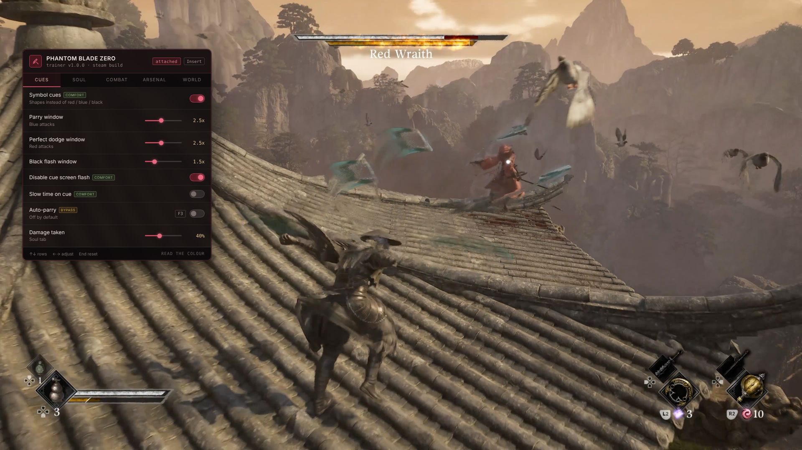

# Phantom Blade Zero — Trainer

**Symbol cues instead of colour. Wider parry and dodge windows. Sha-chi control. All 30+ weapons and 20+ Phantom Edges. Performance relief for the frame drops.**

    

> **[⬇️ Download the latest Phantom Blade Zero trainer](../../releases/latest)**

    

[What this game doesn't have](#what-this-game-doesnt-have) · [The three-colour problem](#the-three-colour-problem) · [Settings](#settings) · [Questions](#questions)

---

## What this game doesn't have

If you have used a trainer for an action game before, roughly half of what you are expecting is missing from this one, and that is the game's fault rather than an oversight.

S-Game have been firm that Phantom Blade Zero is **not a soulslike**, and they built it that way. There is no experience track. There is no stat distribution. There are no souls dropped on death and no run back to recover them. So there is nothing here called "infinite souls," "max stats" or "XP multiplier" — those systems do not exist to write to.

What the game has instead is execution: thirty-plus primary weapons, twenty-plus Phantom Edges, a stagger gauge called **sha-chi**, and a reaction system that asks you to read an attack's colour and respond three different ways. Every setting on this page attaches to one of those, or to something the reviews complained about.

## The three-colour problem

Enemy specials are telegraphed by colour, and each colour wants a different answer:

| Cue | Correct response |
|---|---|
| **Red** | Perfect dodge |
| **Blue** | Parry |
| **Black flash** | Dodge |

It is a good system and it is also the single hardest thing in the game, because you are identifying a colour and selecting one of three responses inside a window measured in frames, through a screen full of sparks and bloom.

**Symbol cues** draws a distinct shape on each attack type instead of relying on hue alone — a ring, a bar, a cross. Nothing about the timing changes; you simply stop having to resolve a colour under pressure. It helps anyone, and it helps considerably more if you have any degree of colour vision deficiency, which the base game makes no provision for.

The window sliders are the other half. Widening the parry window from its default is not the same as parrying for you: you still have to read the cue, pick the right response and press at roughly the right moment. Auto-parry is a separate setting, it is tagged, and it ships off.

| Setting | Tag |
|---|---|
| Symbol cues instead of colour | `comfort` |
| Cue symbol style — ring, bar, cross | `comfort` |
| Cue size and brightness | `comfort` |
| Parry window `1x`–`5x` | `comfort` |
| Perfect dodge window `1x`–`5x` | `comfort` |
| Black flash window `1x`–`5x` | `comfort` |
| Slow time when a cue appears | `comfort` |
| Disable cue screen flash | `comfort` |
| Auto-parry | `bypass` — off by default |
| Auto-perfect-dodge | `bypass` — off by default |

The screen flash option is worth naming separately. Cues come with a sharp full-screen pulse, they arrive in rapid succession during a boss phase, and for anyone photosensitive that is a genuine problem rather than a preference.

## Settings

### Soul

| Setting | Key | Tag |
|---|---|---|
| Infinite health | <kbd>F1</kbd> | — |
| Damage taken `0%`–`100%` | slider | — |
| Damage multiplier `1x`–`50x` | slider | — |
| Extended invincibility frames `1x`–`4x` | slider | `comfort` |
| Infinite dodges | <kbd>F2</kbd> | — |
| Movement and dash speed `1x`–`4x` | slider | — |
| No fall damage | — | — |
| Infinite healing items | <kbd>F3</kbd> | — |

Damage taken as a slider is the one to reach for before infinite health. At 40% a boss still punishes a missed read, which is the part that teaches you the fight, but a single mistake stops costing you the whole attempt.

### Combat

| Setting | Key | Tag |
|---|---|---|
| Sha-chi drain multiplier `1x`–`20x` | slider | — |
| Freeze sha-chi when staggered | <kbd>F4</kbd> | — |
| Boss health `5%`–`150%` | slider | — |
| Enemy health `5%`–`200%` | slider | — |
| One-hit kill on regular enemies | <kbd>F5</kbd> | — |
| Freeze enemy AI | <kbd>F6</kbd> | — |
| Combo never drops when hit | — | — |
| Infinite Phantom Edge charges | <kbd>F7</kbd> | — |
| No Phantom Edge cooldown | — | — |

The sha-chi multiplier is the most interesting knob here. Draining a boss's stagger gauge opens a long combo window and exposes the health bar, and that moment is the game's reward loop. At 3x you reach it more often without removing the fight; at 20x the boss is staggered permanently and there is no fight left.

Boss health goes up as well as down.

### Arsenal

| Setting | Tag |
|---|---|
| Unlock all 30+ primary weapons | `save` |
| Unlock all 20+ Phantom Edges | `save` |
| Unlock all skills and moves | `save` |
| Free weapon switching mid-combo | — |
| No weapon swap cooldown | — |
| Unlock all outfits | `save` |

Thirty weapons is a lot of content behind progression, and unlocking them all at once is the quickest way to make none of them feel special. It is here for second playthroughs.

### World and navigation

| Setting | Key | Tag |
|---|---|---|
| Enhanced objective markers | <kbd>F8</kbd> | `fix` |
| Reveal the map | — | — |
| Highlight interactables and collectibles | slider | — |
| Fast travel anywhere | <kbd>F9</kbd> | — |
| Noclip | <kbd>F10</kbd> | `fix` |
| Save and load position | <kbd>F12</kbd> / <kbd>⇧F12</kbd> | `fix` |
| Movement speed outside combat `1x`–`6x` | slider | — |

> [!NOTE]
> **The `fix` tag** marks settings that exist because of a known problem with the game rather than because the game is too hard.
>
> Reviewers consistently flagged weak quest guidance and some boss arenas behaving badly. Enhanced markers address the first. Noclip plus save-position addresses the second — if an arena traps you or a boss falls out of the world, these get you out without losing the run. A patch shortly after launch fixed some of this, so check the game's notes before assuming you still need them.

### Performance

The other consistent criticism, especially during boss fights.

| Setting | Tag |
|---|---|
| Effect density `25%`–`100%` | `fix` |
| Reduce particle effects | `fix` |
| Reduce bloom and lens flare | `fix` |
| Disable motion blur | `fix` |
| Disable chromatic aberration | `fix` |
| Frame pacing smoothing | `fix` |

None of this touches the simulation. It reduces what the renderer is being asked to draw during the exact moments the frame rate drops, which is boss fights with heavy effects. If your frame rate is holding fine, skip the whole section.

### Display

Field of view `60`–`120 deg`, free camera <kbd>F11</kbd>, hide interface, camera distance, disable screen shake, extended photo mode. Plus rolling save backup, read-only mode, achievement blocking, rebindable menu key and overlay opacity.

## Keys

<kbd>Insert</kbd> opens the menu · <kbd>End</kbd> resets everything · <kbd>F1</kbd> health · <kbd>F2</kbd> dodges · <kbd>F3</kbd> healing · <kbd>F4</kbd> freeze sha-chi · <kbd>F5</kbd> one-hit kill · <kbd>F6</kbd> freeze AI · <kbd>F7</kbd> Phantom Edge · <kbd>F8</kbd> objective markers · <kbd>F9</kbd> fast travel · <kbd>F10</kbd> noclip · <kbd>F11</kbd> free camera · <kbd>F12</kbd> save position

All rebindable. Arrows and <kbd>Enter</kbd> navigate without a mouse.

## Two configurations

**Keep the combat, lose the barrier:** symbol cues, parry window 2.5x, perfect dodge window 2.5x, damage taken 50%. You are still reading every telegraph, still choosing between three responses, still learning the boss. You simply get a window a human hand can hit and a mistake that costs less than the whole attempt. For most people struggling with this game, that is the entire fix.

**For photographs:** free camera, hide interface, effect density 100%, disable motion blur, extended photo mode. The art direction is the best thing about this game after the combat, and the default camera does not do it justice.

The setting to think hardest about is **sha-chi drain at high values**. It looks like a minor tuning knob and it quietly removes the boss design — a permanently staggered boss is a training dummy with a health bar.

Settings tagged `save` write to persistent progression and a patch can invalidate them. The rolling backup runs on attach by default.

## Questions

Is there any risk to my account?

No. Phantom Blade Zero is single-player with no multiplayer, no leaderboards and no anti-cheat. Achievements unlock locally and can be suppressed from the Display section if you would rather earn them cleanly.

Why are there no stat or XP cheats?

Because the game has no stats or XP. S-Game deliberately built it without RPG progression — no experience track, no stat points, no souls to recover on death. A trainer cannot write to systems that do not exist.

I cannot tell the red and blue attacks apart in time.

Symbol cues, in the first section. Each attack type gets a distinct shape instead of relying on colour, so you are matching a form rather than resolving a hue mid-fight. Pair it with the window sliders at around 2.5x and most people stop bouncing off the reaction system entirely.

Can it help with the frame rate drops in boss fights?

Somewhat. The Performance section lowers effect density, particles and post-processing, which is what the renderer is struggling with during heavy boss phases. It will not fix a CPU bottleneck or a driver problem, and it is not a substitute for the developers' own optimisation patches.

I got stuck in a boss arena.

Noclip and save-position, both tagged <code>fix</code> for exactly that reason. Save your position before a boss, and if the arena traps you, load it back. Several reviews reported arena problems, and a post-launch patch addressed some of them.

Does it work on the Epic version, or on PS5?

Steam and Epic both work — launch through whichever client you own it on. PS5 cannot run PC tools of any kind; the console does not permit it.

Settings stopped working after an update.

The game is patching actively in its launch window, and each patch moves the addresses these settings write to. They fail individually rather than all at once. Match your build number against the release notes here, or enable read-only mode to see which values the trainer can still read correctly.

My antivirus flagged the download.

Examining and modifying another running program's memory is what this tool does, and it is indistinguishable from what several unpleasant classes of software do, so scanners flag the category on principle rather than judging individual cases. Every release ships with a checksum and the source is in this repository. Add an exclusion if you are comfortable doing so; declining is equally reasonable.

## When something misbehaves

Combat settings bind when a fight begins, so toggling them in a safe area does nothing until an enemy engages. Cue settings bind to the attack system and need a combat encounter to take effect — test them on regular enemies before a boss rather than during one.

Noclip in an action game with arena boundaries will occasionally drop you below the world, which is why save-position exists alongside it. Press <kbd>F12</kbd> before you use it.

If the menu will not open, another overlay has taken <kbd>Insert</kbd> — Steam's own overlay and Discord account for almost every case. If effect density is at 25% and the game still stutters, the bottleneck is somewhere this cannot reach.

## Version history

**1.0.0** — 29 October 2026 — first build, launch week. 45+ settings across Reaction cues, Soul, Combat, Arsenal, World, Performance and Display. Auto-parry and auto-dodge off by default; `fix`-tagged settings included for the arena and navigation issues raised in reviews.

---

Unofficial fan tool with no connection to S-Game or Valve. Phantom Blade Zero and everything in it belongs to them. Modifying a live process can crash it or damage a save, so keep backups and proceed knowingly. MIT licence.

